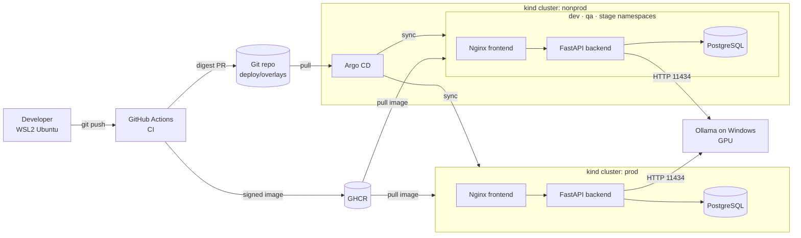

# kestrel

A chat assistant with a personality: a web chat UI, an API that calls a local LLM (Ollama on the GPU), and conversation memory stored in PostgreSQL.

Around it sits a full delivery platform: one image promoted by digest through Dev → QA → Stage → Prod with GitOps, supply-chain security (SBOMs, signing, admission policy), observability with an SLO, and canary releases with automatic rollback.

Status: Week 1 — foundation.

## Architecture (target, built over 8 weeks)

